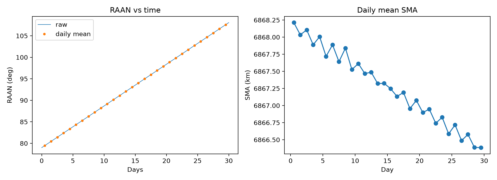

# 500 km Sun-Synchronous CubeSat Orbit: Mission Analysis in GMAT

## Objective
Design and analyse a low Earth orbit for a 3U CubeSat (4 kg) in NASA's GMAT.
The study checks that the orbit is sun-synchronous, how much time the
satellite spends in Earth's shadow, and how long it stays in orbit
before atmospheric drag brings it down.

## Method
- Tool: GMAT R2025a, with Python (pandas, matplotlib) for plots
- Orbit: 500 km altitude, inclination 97.4 deg, eccentricity 0.001, RAAN 79 deg
- Spacecraft: mass 4 kg, drag area 0.03 m2, Cd 2.2, Cr 1.3
- Force model: Earth gravity JGM-2 (8x8), JacchiaRoberts drag,
  solar radiation pressure, Sun and Moon as point masses
- Propagator: RungeKutta89, 30-day run

## Results
| Check | Result |
|---|---|
| RAAN drift | [X] deg/day (expected about 0.985) |
| SMA loss in 30 days | [X] km |
| Eclipse per orbit | [X] min ([X]% sunlit) |

Orbital lifetime from 120 km re-entry:

| Altitude | Quiet sun (F10.7 = 100) | Active sun (F10.7 = 200) |
|---|---|---|
| 400 km | [X] | [X] |
| 500 km | [X] | [X] |
| 600 km | [X] | [X] |

[Write 2 or 3 sentences: what the numbers mean, for example why the
orbit is sun-synchronous and how altitude changes lifetime.]

## How to reproduce
1. Open `gmat/flagship_500km.script` in GMAT and press Run
2. Copy the report files from GMAT's output folder into `results/`
3. `pip install pandas numpy matplotlib`
4. `python src/plot_results.py`

## Limitations
- Constant drag area and Cd (no attitude model)
- Constant solar flux values, real solar activity varies
- Lifetime depends strongly on solar activity, so results are a range

## Files
- `gmat/`: GMAT script
- `src/plot_results.py`: analysis and plots
- `results/`: reports and plots
- `docs/report.pdf`: full report

## Author
Manmeet Saini, B.Tech Aerospace Engineering, MIT ADT University
www.linkedin.com/in/manmeet-saini-1916jan